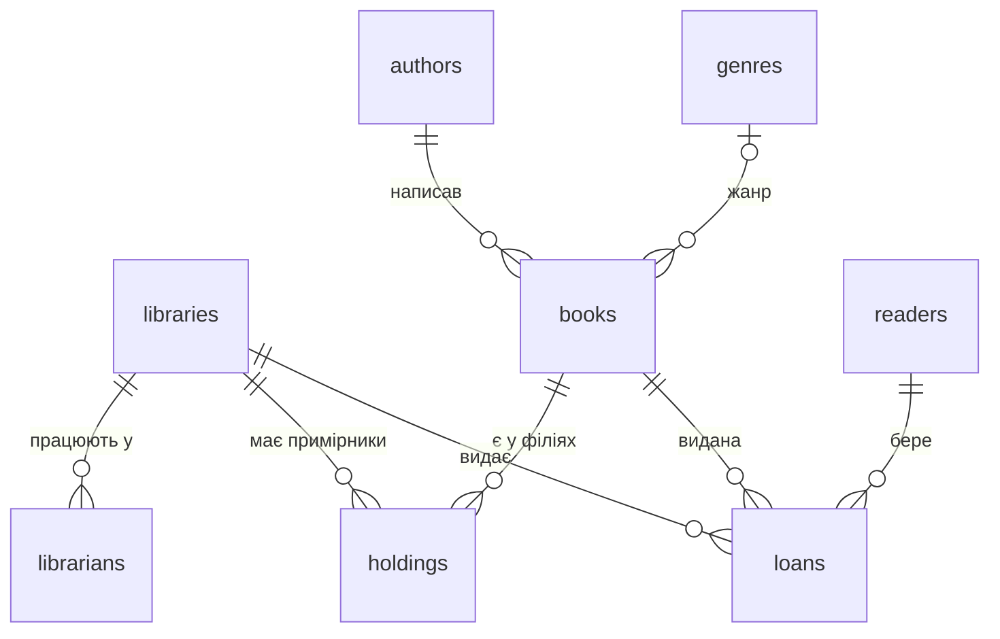

# cloud-labs — Library API

**Автор:** Валентина Бруданіна, ІР, Львівська політехніка  
**Варіант:** бібліотека (філії, каталог книг, читачі, видача й повернення книг)

REST API мережі бібліотек на Flask + MySQL, розгорнутий в AWS: ECS Fargate за Application Load Balancer, RDS MySQL у приватних підмережах, кеш ElastiCache (Valkey), черга SQS з обробником, образи в ECR і автодеплой з GitHub Actions через OIDC. Уся інфраструктура описана в Terraform.

## Структура проєкту

| Шлях | Що там |
|---|---|
| `app/` | Код застосунку, `Dockerfile`, обробник черги `worker.py` |
| `app/library/models.py` | Схема бази даних (SQLAlchemy) |
| `app/library/routes/` | Ендпоінти: філії, каталог, читачі й бібліотекарі, видачі |
| `app/library/seed.py` | Демонстраційні дані |
| `compose.yaml` | Локальний запуск: API, обробник, MySQL, Valkey, ElasticMQ |
| `infra/` | Terraform: VPC, ECR, RDS, ECS, ALB, кеш, черга, масштабування, моніторинг, OIDC, бюджет |
| `.github/workflows/deploy.yaml` | CI/CD: тести на локальному стеку → образ з тегом `github.sha` → оновлення ECS |
| `tests/` | Функціональні тести API та тести ідемпотентності |
| `loadtest/` | Сценарії k6 |
| `docs/` | Опис рішень і результати лабораторних |

## База даних



Детальний опис таблиць і обмежень — у [docs/DATABASE.md](docs/DATABASE.md).

## API

| Метод і шлях | Що робить |
|---|---|
| `GET /health` | Перевірка для ALB |
| `GET /stats` | Лічильники MySQL і кешу (для звітів навантажувальних тестів) |
| `GET /libraries?limit=N` | Останні N філій (за замовчуванням 50), **кешується** |
| `GET /libraries/{id}` | Одна філія |
| `GET /libraries/{id}/books` | Каталог філії: книги і скільки примірників на полиці |
| `GET /libraries/{id}/librarians` | Працівники філії |
| `POST /libraries` | Створити філію, підтримує `Idempotency-Key` |
| `POST /libraries/async` | Створити філію через чергу SQS → `202` і `job_id` |
| `GET /jobs/{id}` | Статус асинхронної задачі |
| `PUT`, `DELETE /libraries/{id}` | Змінити або видалити філію |
| `GET/POST /genres` | Жанри (з кількістю книг) |
| `GET/POST/PUT/DELETE /authors` | Автори; автора з книгами видалити не можна |
| `GET /books?genre_id=&author_id=&q=` | Пошук книг |
| `GET/POST/PUT/DELETE /books/{id}` | Книги; `GET` показує, у яких філіях є примірники |
| `POST /holdings` | Поставити примірники книги у філію |
| `GET/POST/PUT/DELETE /librarians`, `/readers` | Працівники і читачі |
| `GET /loans?active=true&overdue=true` | Видачі, активні або прострочені |
| `POST /loans` | Видати книгу: `{reader_id, library_id, book_id, days}` |
| `POST /loans/{id}/return` | Повернути книгу |

Видача блокує рядок `holdings` (`SELECT … FOR UPDATE`), тому двоє читачів не можуть одночасно взяти останній примірник. Читач може мати на руках не більше 5 книг.

## Локальний запуск

У файлі `.env` треба вказати свій `DB_PASSWORD`.

```bash
cp .env.example .env
docker compose up --build -d
docker compose exec app python -m library.seed
curl localhost:8000/libraries
```

Тести (потрібен запущений стек):

```bash
pip install -r tests/requirements.txt
python -m pytest -v tests/
```

Дані MySQL зберігаються у volume `db_data` і переживають `docker compose down` (видаляються лише з `down -v`).

## Розгортання в AWS

У `infra/terraform.tfvars` треба вказати пароль бази і пошту для сповіщень.

```bash
cd infra
cp terraform.tfvars.example terraform.tfvars
terraform init
terraform apply
terraform output app_url
terraform output github_role_arn
```

`terraform apply` також збирає і пушить початковий образ, тому локально потрібні `docker` і `aws` CLI.

ARN ролі записати в GitHub: Settings → Secrets and variables → Actions → Variables → `AWS_ROLE_ARN`. Після цього кожен push у `main` запускає тести і деплой.

Після першого `apply` AWS надішле лист для підтвердження підписки на сповіщення — його треба підтвердити.

Прибирання: `terraform destroy`.

**Публічна адреса:** http://library-alb-1033095156.eu-north-1.elb.amazonaws.com

## Архітектура і безпека

- Із інтернету доступний лише ALB (порт 80). Задачі ECS — у приватних підмережах без публічних IP і приймають трафік тільки від security group ALB.
- RDS — у приватних підмережах, `publicly_accessible = false`, порт 3306 відкритий тільки для security group застосунку. Так само кеш (6379).
- NAT немає: задачі звертаються до ECR, S3, CloudWatch Logs і SQS через VPC endpoints.
- Секрети не комітяться: пароль бази передається через `terraform.tfvars` / `.env` у змінні середовища контейнера.
- GitHub Actions отримує доступ до AWS через OIDC і роль `library-github`, обмежену гілкою `main` цього репозиторію; довговічних ключів немає.
- API і обробник мають окремі IAM-ролі: API може лише надсилати в чергу, обробник — лише читати й видаляти повідомлення.

## Лабораторна 2: масштабування, моніторинг, кеш, черга

| Що | Код | Документ |
|---|---|---|
| Автомасштабування ECS за CPU (1–4 задачі, ціль 60 %) | `infra/autoscaling.tf` | [docs/AUTOSCALING.md](docs/AUTOSCALING.md) |
| Сценарій k6 «1 запис + 9 читань» | `loadtest/` | [docs/LOADTEST.md](docs/LOADTEST.md) |
| Панель CloudWatch (`terraform output dashboard_url`) | `infra/monitoring.tf` | [docs/AUTOSCALING.md](docs/AUTOSCALING.md) |
| Аларм CPU > 70 % 2 хв → email | `infra/monitoring.tf` | [docs/ALERTS.md](docs/ALERTS.md) |
| Cache-aside для `GET /libraries` на ElastiCache (Valkey) | `infra/cache.tf`, `app/library/cache.py` | [docs/CACHE.md](docs/CACHE.md) |
| Черга SQS + обробник, що масштабується від 0 до 4 | `infra/sqs.tf`, `infra/worker.tf`, `app/worker.py` | [docs/QUEUE.md](docs/QUEUE.md) |
| `Idempotency-Key` для записів | `app/library/idempotency.py`, `tests/` | [docs/IDEMPOTENCY.md](docs/IDEMPOTENCY.md) |
| Розклад: удень мінімум 2 задачі, уночі 1 | `infra/schedule.tf` | [docs/SCHEDULE.md](docs/SCHEDULE.md) |

Додаткові змінні в `terraform.tfvars` (необов'язкові): `alert_email`, `cache_enabled`, `cache_ttl_seconds`, `cpu_target`.
