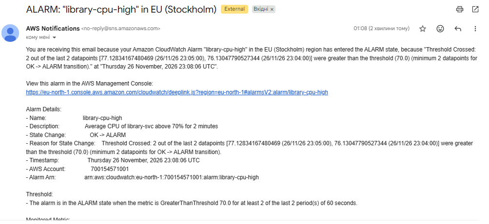
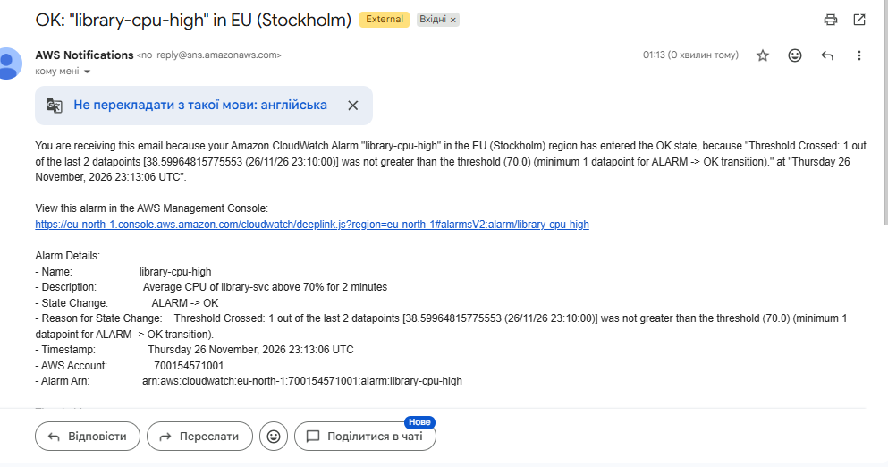

# Сповіщення

**Покращує:** про перевантаження дізнаємося з листа через ≈ 4 хв після того, як процесор перейшов поріг, а не від користувачів.  
**Коштує:** лист приходить із затримкою; поріг треба підбирати, можливі хибні спрацювання.  
**Відкинули:** p95 > 500 мс (у тестах p95 майже весь час був нижче 150 мс — аларм не спрацював би), спрацювання без періоду очікування (реагувало б на кожен стрибок).

Сповіщення налаштоване в `infra/monitoring.tf`: аларм `library-cpu-high`, SNS-топік `library-alerts` і підписка на пошту.

## Умова

Якщо середній процесор сервісу дві хвилини поспіль вище 70 %, приходить лист ALARM. Коли процесор опускається нижче 70 %, приходить лист OK.

Після першого `terraform apply` AWS надсилає лист з підтвердженням підписки. Поки посилання в ньому не натиснуте, сповіщення не приходять.

## Чому така умова

Масштабування тримає процесор близько 60 %. Якщо він довго вище 70 %, значить автоматика не встигає або вже працюють усі чотири задачі. Саме тоді варто, щоб людина глянула на сервіс. Дві хвилини очікування відсікають короткі стрибки, наприклад, коли стартує нова задача.

Процесор обрано ще й тому, що його видно на тій самій панелі, що й масштабування. Латентність залежить і від бази, і від мережі, тому з нею легше отримати хибну тривогу.

## Що було під час тесту

Перевіряла на першому прогоні, з кешем, 45 користувачів. Навантаження почалося о 01:02. О 01:04 і 01:05 процесор був 76 % і 77 %, і о 01:08 прийшов лист ALARM.

О 01:10 процесор впав до 39 %, бо вже працювала друга задача, а тест ішов на спад. О 01:13 прийшов лист OK.

Від першої хвилини над порогом до листа минуло близько 4 хвилин. Дві з них аларм чекає, щоб процесор протримався високим. Ще приблизно дві хвилини метрика доходить до CloudWatch і обробляється. Лист OK приходить швидше, бо для нього вистачає однієї нормальної хвилини.

У другому прогоні, без кешу, працювали три задачі, процесор не піднімався вище 49 %, і аларм правильно мовчав.

## Чи нормально чекати 4 хвилини

Для такого сповіщення так. Воно приходить, коли сервіс ще працює, а масштабування вже саме додає задачі. Лист просто попереджає, що сервіс на межі.

Але якщо сервіс почне повертати помилки, 4 хвилини — це забагато. Для справжнього сервісу варто додати окреме швидке сповіщення на помилки 5xx і на чергу невдалих повідомлень `library-writes-dlq`. А надсилати їх краще в месенджер, бо пошту часто читають пізно.
