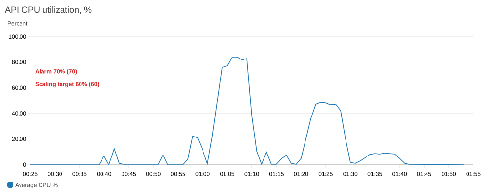
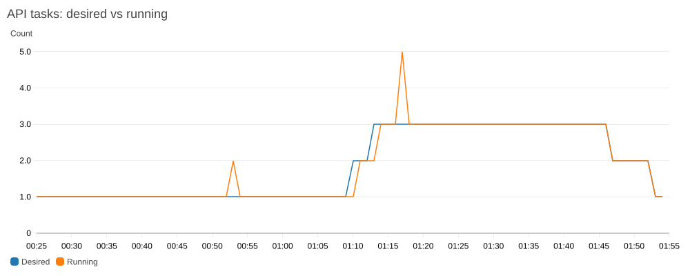

# Автомасштабування

**Покращує:** витримку піку — під навантаженням 45 користувачів сервіс сам виріс з 1 до 3 задач, і CPU впав з 84 % на одній задачі до ≈ 47 % на трьох.  
**Коштує:** ≈ $0,014 за годину кожної додаткової задачі; реакція ≈ 7 хв; застосунок мусить бути stateless.  
**Відкинули:** масштабування за кількістю запитів (упираємося в CPU, а не в базу), одну велику задачу замість кількох, ціль 80 % (не лишається запасу на час запуску нової задачі).

**Панель — покращує:** усе потрібне видно на одному екрані — задачі, CPU, запити, p95, помилки, база, кеш і черга.  
**Коштує:** плата за метрики Container Insights.  
**Відкинули:** середню латентність замість p95, окремий Grafana.

Політика описана в `infra/autoscaling.tf`, панель — в `infra/monitoring.tf`. Ті самі графіки можна зберегти картинками без входу в консоль: `bash loadtest/export-graphs.sh 90`.

## Параметри

Сервіс масштабується за середнім завантаженням процесора. Ціль 60 %, мінімум 1 задача, максимум 4. Після додавання задачі політика чекає 60 секунд, після вилучення 5 хвилин.

## Чому процесор і чому 60 %

Під час тестів процесор задачі піднімався до 84 %, а процесор бази за весь час не перевищив 11 %. Отже, першим закінчується саме процесор сервісу, і масштабувати треба за ним. Якби сервіс більше чекав на базу, ніж рахував сам, краще було б масштабувати за кількістю запитів.

Нова задача з'являється не миттєво, у наших тестах приблизно через 7 хвилин. Поки її немає, все навантаження тримають ті задачі, що вже працюють. Ціль 60 % залишає запас: навантаження може вирости ще на дві третини, перш ніж процесор упреться в 100 %. Якщо поставити 80–90 %, задачі перевантажаться раніше, ніж прийде допомога. Якщо поставити 30–40 %, зайві задачі працюватимуть майже завжди і коштуватимуть грошей.

## Що таке cooldown

Cooldown — це пауза після зміни кількості задач. Нова задача стартує не одразу, і якийсь час процесор ще високий. Без паузи політика вирішила б, що допомоги досі немає, і додавала б задачі знову і знову, аж до максимуму. Потім процесор упав би, задачі почали б зникати, і все повторилося б по колу. Тому задачі додаються з паузою в хвилину, а прибираються з паузою в п'ять.

## Що показали тести

Тести описані в [LOADTEST.md](LOADTEST.md). Час — за Києвом.

Перший прогін, з кешем, почався о 01:02 на одній задачі. Уже о 01:04 процесор перетнув 60 % і до 01:09 тримався на рівні 76–84 %. Політика вирішила додати задачу приблизно о 01:09, а друга задача реально почала приймати запити о 01:11. Третя з'явилась о 01:14, вже після тесту. Тобто майже весь цей прогін сервіс тягнула одна перевантажена задача, і це добре видно в його латентності.

Короткий пік до п'яти задач о 01:17 — це не масштабування. Тоді я перезапускала сервіс з вимкненим кешем, і кілька хвилин старі й нові задачі працювали одночасно.

Другий прогін, без кешу, почався о 01:20, коли після першого ще працювали три задачі. Процесор тримався на 36–49 %, тобто нижче цілі, тож нових задач не знадобилось.

## Чому задача з'являється не одразу

Від перетину 60 % до другої робочої задачі минуло близько 7 хвилин. Метрика процесора приходить раз на хвилину і з невеликим запізненням. Політика чекає кілька хвилин високого процесора поспіль, щоб не реагувати на випадкові стрибки. Потім задачу треба запустити, завантажити образ, підключитися до бази і пройти перевірку `/health`, і тільки тоді балансувальник починає слати на неї запити.

Звідси висновок: при різкому піку масштабування за процесором не встигає, тому потрібен запас заздалегідь. Для цього вдень мінімум 2 задачі (див. [SCHEDULE.md](SCHEDULE.md)).

## Чому задачі прибираються набагато пізніше

Після тестів три задачі працювали до 01:46. Друга зникла о 01:47, третя — о 01:53. Для вилучення політика чекає 15 хвилин низького процесора, а між вилученнями ще 5 хвилин паузи. Так зроблено навмисно: якщо прибрати задачу зарано, а навантаження повернеться, нову доведеться знову чекати хвилин сім. Тому задачі додаються швидко, а прибираються повільно.
