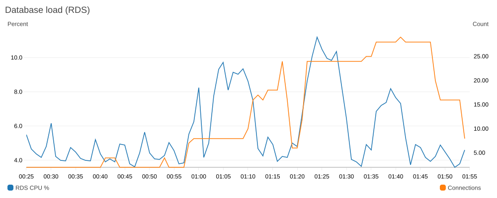

# Кешування

**Покращує:** менше запитів до MySQL на найпопулярнішому ендпоінті `GET /libraries` і нижча латентність його відповіді.  
**Коштує:** список філій може відставати від бази до 45 с; ще один сервіс в AWS (ElastiCache `cache.t4g.micro`).  
**Відкинули:** кеш у пам'яті процесу, очищення кешу після кожного запису (у сценарії запис іде на кожні 9 читань, тож кеш майже не встигав би спрацювати).

## Як працює

`GET /libraries` працює за схемою **cache-aside** (`app/library/routes/libraries.py`, `app/library/cache.py`):

1. Ключ `libraries:list:<limit>` шукається у Valkey.
2. Якщо є — відповідь одразу з кешу, заголовок `X-Cache: HIT`.
3. Якщо немає — запит до MySQL, результат кладеться в кеш на `CACHE_TTL` (45 с), `X-Cache: MISS`.
4. Якщо кеш вимкнений — `BYPASS`; якщо Valkey недоступний — `ERROR`, і відповідь береться з бази. Сервіс через кеш не падає (таймаут з'єднання 0,5 с).

Окрема філія (`GET /libraries/{id}`) і каталог філії не кешуються: так нову філію видно одразу після створення, а кількість примірників на полиці завжди актуальна — для видачі книг це важливо.

Інфраструктура: `infra/cache.tf` — Valkey 8.0 у приватних підмережах, шифрування при зберіганні й передаванні (`rediss://`), доступ лише з security group застосунку. Локально — контейнер `valkey/valkey`.

## Чому не кеш у пам'яті процесу

Під навантаженням працює до 4 задач по 2 процеси gunicorn — це 8 окремих кешів. Кожен наповнювався б сам, тож запитів у базу було б більше; різні користувачі бачили б різні версії списку залежно від задачі, на яку потрапили; а нова задача стартувала б з порожнім кешем саме в пік. Спільний Valkey — один для всіх задач.

## Як порівнювати

Два прогони з однаковою кількістю користувачів:

```bash
# у terraform.tfvars: cache_enabled = false → terraform apply → дочекатися деплою
VUS=45 ./loadtest/run.sh no-cache
# cache_enabled = true → terraform apply
VUS=45 ./loadtest/run.sh with-cache
```

Кількість запитів до бази береться з `GET /stats` (лічильники `Questions` і `Com_select` MySQL), частка влучань — з метрики `cache_hit` у k6 і з `hits/misses` Valkey.

## Результати

> Заповнити після двох прогонів у AWS.

| | Без кешу | З кешем |
|---|---|---|
| p95 | мс | мс |
| Запитів за секунду | | |
| Запитів до бази за секунду | | |
| Влучання в кеш | — | % |
| Максимум задач | | |




Очікування: влучань має бути майже 100 %, бо промах трапляється раз на 45 с на кожне значення `limit`. Кількість запитів за секунду в обох прогонах буде приблизно однаковою: користувачі чекають на відповідь і роблять паузи, тож навантаження задає кількість користувачів, а не швидкість сервера. Різниця має бути в запитах до бази і в латентності.

## Застарілі дані

Нову філію видно за її адресою одразу, а в списку — максимум через 45 с. Варіанти зменшити це вікно: коротший TTL (більше запитів у базу), видаляти ключі списку після запису (при частих записах кеш майже не працює), оновлювати кеш одразу після запису (write-through) або показувати автору його власний запис окремо від кешованого списку.
