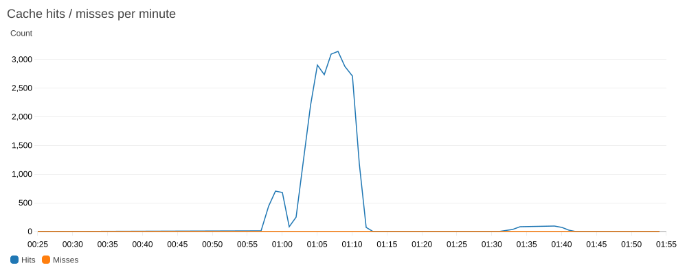

# Кешування

**Покращує:** запити до бази з 346 до 216 за секунду (−38 %); 99,9 % запитів списку філій обслуговує кеш.  
**Коштує:** список може бути застарілим до 45 с; ще один сервіс (ElastiCache `cache.t4g.micro`).  
**Відкинули:** кеш у пам'яті процесу, очищення кешу при кожному записі (записів багато — кеш майже не встигав би спрацювати).

## Як працює кеш

Найчастіший запит у тесті — список філій `GET /libraries`. Він працює за схемою cache-aside. Сервіс спершу шукає список у кеші. Якщо знайшов, одразу повертає. Якщо ні, бере з бази, кладе в кеш на 45 секунд і повертає. Чи була відповідь з кешу, видно із заголовка `X-Cache`: `HIT` або `MISS`. Якщо кеш раптом недоступний, сервіс не падає, а просто йде в базу.

Кеш — це Valkey (те саме, що Redis) в ElastiCache, у приватній мережі. Локально замість нього звичайний контейнер. Код у `app/library/cache.py`, інфраструктура в `infra/cache.tf`.

Окрема філія і каталог книг філії не кешуються. Так нову філію видно одразу, а кількість книг на полиці завжди точна — це важливо, коли книгу видають читачу.

## Чому не кеш у пам'яті процесу

Під навантаженням працює до чотирьох задач, у кожній по два процеси. Якби кожен процес мав свій кеш, вийшло б вісім окремих копій. Кожна наповнювалась би сама, тож у базу йшло б більше запитів. Різні користувачі могли б бачити різні версії списку, залежно від того, на яку задачу потрапили. А нова задача стартувала б з порожнім кешем саме тоді, коли навантаження найбільше. Спільний Valkey один на всіх, тому таких проблем немає.

## Як порівнювали

Тест прогнали двічі по 45 користувачів: з кешем і без. Кеш вимикається змінною `cache_enabled = false` у `terraform.tfvars`, після цього `terraform apply` і перезапуск сервісу. Що кеш справді вимкнений, перевірила заголовком: відповідь прийшла з `X-Cache: BYPASS`.

## Результати

| | З кешем | Без кешу |
|---|---|---|
| Запитів за секунду | 93 | 99 |
| Запитів до бази за секунду | 216 | 346 |
| Влучання в кеш | 99,9 % | — |
| Процесор бази, максимум | 9,7 % | 11,2 % |
| p95 | 120 мс | 59 мс |
| Задач під час тесту | 1 → 3 | 3 |

З кешем у базу йшло 216 запитів за секунду, без кешу — 346. Тобто кеш зняв з бази більше третини роботи. Кількість запитів до сервісу в обох прогонах майже однакова, бо кожен користувач у тесті чекає відповідь і робить паузу, і швидкість задає кількість користувачів, а не сервер.

Майже всі звернення до кешу були влучаннями: 22 436 влучань і лише 20 промахів за 10 хвилин. Промах трапляється, коли закінчується 45 секунд і список треба знову взяти з бази.

## Чому без кешу p95 вийшов кращим

На перший погляд дивно: без кешу 95 % запитів вклалися в 59 мс, а з кешем лише в 120 мс. Але кеш тут ні до чого. Прогін з кешем почався на одній задачі, і перші дев'ять хвилин вона працювала на 77–84 % процесора, поки масштабування додавало нові. Запити чекали своєї черги в перевантаженій задачі, звідси й повільніші відповіді. А прогін без кешу почався, коли після першого ще працювали три задачі, і процесор був лише ≈ 47 %.

Тому латентність цих двох прогонів напряму порівнювати не можна, а ефект кешу видно по навантаженню на базу. Щоб порівняти чесно і латентність, треба перед кожним прогоном дочекатися, поки сервіс повернеться до однієї задачі.

Ще один висновок: база в нас зараз не вузьке місце, її процесор не піднімався вище 11 %. Тож кеш тут більше запас для бази на майбутнє, ніж прискорення відповідей.

## Застарілі дані

Нову філію одразу видно за її адресою, бо окрема філія не кешується. А от у списку вона може з'явитися лише через 45 секунд, коли оновиться кеш.

Цей час можна зменшити кількома способами. Найпростіше — поставити менший термін, але тоді частіше доведеться ходити в базу. Можна видаляти список з кешу після кожного запису, але записів у тесті багато, і кеш майже не працював би. Ще можна оновлювати кеш одразу після запису або показувати користувачу його нову філію окремо від кешованого списку.
