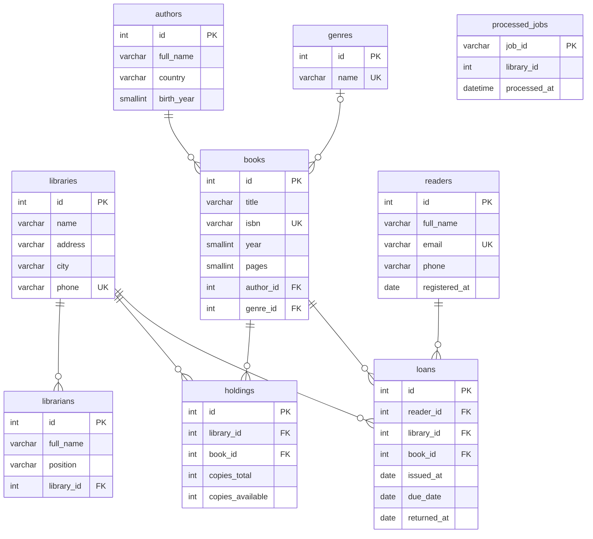

# База даних

MySQL 8.4 (локально контейнер, в AWS — RDS `db.t3.micro`). Таблиці створюються під час старту застосунку з моделей у `app/library/models.py`. Демонстраційні дані додає `python -m library.seed`.

## Таблиці

| Таблиця | Призначення | Ключові поля й обмеження |
|---|---|---|
| `libraries` | Філії бібліотеки | `phone` UNIQUE, індекс за `city` |
| `librarians` | Працівники філії | FK `library_id` → `libraries` (ON DELETE CASCADE) |
| `genres` | Жанри | `name` UNIQUE |
| `authors` | Автори | `full_name`, `country`, `birth_year` |
| `books` | Каталог книг | `isbn` UNIQUE; FK `author_id` (RESTRICT), FK `genre_id` (SET NULL) |
| `holdings` | Примірники книги у філії | UNIQUE (`library_id`, `book_id`); CHECK `0 ≤ copies_available ≤ copies_total` |
| `readers` | Читачі | `email` UNIQUE, `registered_at` |
| `loans` | Видачі книг | `issued_at`, `due_date`, `returned_at` (NULL — книга ще на руках) |
| `processed_jobs` | Виконані задачі з черги | PK `job_id` — захист від повторної доставки |

## Зв'язки

## Чому так

**Примірники окремою таблицею.** Одна й та сама книга є в кількох філіях у різній кількості. Таблиця `holdings` зберігає це як зв'язок «багато до багатьох» з атрибутами: скільки примірників усього і скільки зараз на полиці. Обмеження CHECK не дає кількості стати від'ємною або більшою за загальну навіть при помилці в коді.

**Видача — транзакція з блокуванням.** `POST /loans` читає рядок `holdings` через `SELECT … FOR UPDATE`, зменшує `copies_available` і створює запис у `loans` в одній транзакції. Якщо двоє читачів одночасно беруть останній примірник, другий чекає на блокування, бачить нуль і отримує `409`. Повернення працює дзеркально.

**Видача не видаляється після повернення.** Заповнюється `returned_at`, тож зберігається історія читача, а прострочені видачі легко знайти запитом `returned_at IS NULL AND due_date < CURDATE()` (`GET /loans?overdue=true`).

**Видалення.** Автора з книгами видалити не можна (`RESTRICT` і перевірка в API → `409`), щоб не втратити каталог випадково. Видалення жанру лишає книги без жанру (`SET NULL`). Видалення філії прибирає її працівників, примірники і видачі (`CASCADE`).

**Унікальні поля** (`phone` філії, `isbn`, `email` читача) перевіряються самою базою. Порушення API перетворює на `409 Conflict`. На унікальності телефону філії також тримаються тести ідемпотентності: повтор без ключа отримує `409`.
