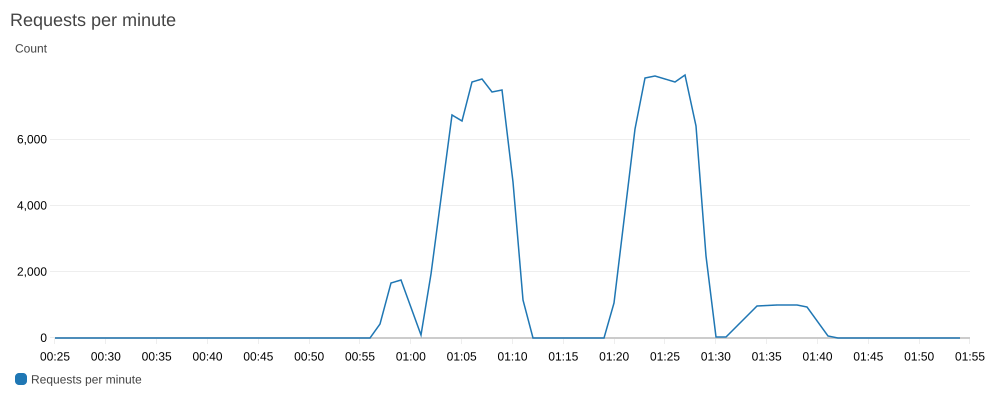
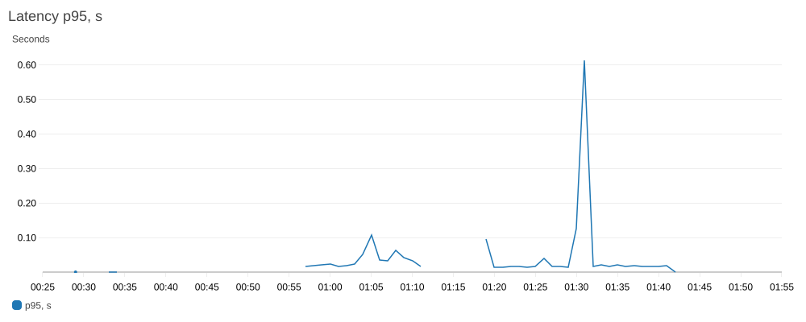

# Навантажувальне тестування

**Покращує:** нічого в сервісі — це вимірювання: з «невідомо» до p50 37–41 / p95 59–120 / p99 120–241 мс при ≈ 95 запитах/с.  
**Коштує:** час на сценарій і ≈ 30 хв на прогін разом з очікуванням вилучення задач; навантаження в хмарі.  
**Відкинули:** Locust (k6 запускається однією командою), постійний потік запитів для основного сценарію (потрібні користувачі з паузами і профіль «мало записів»).

Сценарій написаний на k6 і лежить у `loadtest/scenario.js`.

## Як запустити

```bash
VUS=45 ./loadtest/run.sh назва-прогону
```

`VUS` — це кількість користувачів, а назва потрібна, щоб відрізняти прогони. Адресу сервісу скрипт бере з Terraform сам. Результат зберігається в `loadtest/results/назва-прогону.json`, а в кінці виводу є рядок `SUMMARY` з усіма числами. Графіки з CloudWatch після тестів зберігає `bash loadtest/export-graphs.sh 90`.

## Що робить користувач

Кожен віртуальний користувач по колу створює одну філію, а потім робить дев'ять читань. Він чотири рази отримує список філій, відкриває щойно створену філію, ще дві випадкові і двічі дивиться каталог книг випадкової філії. Між запитами пауза 0,3 секунди.

Тест триває 10 хвилин. Перші 3 хвилини кількість користувачів росте від нуля, 5 хвилин тримається на одному рівні, і за останні 2 хвилини падає до нуля.

## Як підбиралась кількість користувачів

Спершу був короткий прогін з 10 користувачами. Процесор єдиної задачі тримався близько 21–22 %. Щоб він стабільно був вище 60 %, користувачів треба приблизно вчетверо більше, тому для основних прогонів взято 45.

## Результати

Основних прогонів було два: з кешем (01:02–01:12) і без кешу (01:20–01:30). Порівняння кешу описане в [CACHE.md](CACHE.md).

За 10 хвилин прогону з кешем сервіс обробив 56 142 запити, у середньому 93 за секунду. Помилка була лише одна, це 0,002 %. Половина запитів виконалась швидше ніж за 41 мс (p50), 95 % вклались у 120 мс (p95), а 99 % у 241 мс (p99).

У прогоні без кешу запитів було 59 251, по 98 за секунду, і 4 помилки, менше 0,01 %. Тут p50 37 мс, p95 59 мс і p99 120 мс.





Прогін з кешем вийшов повільнішим тому, що майже весь час його тримала одна задача на 77–84 % процесора — масштабування додало другу лише о 01:11. Прогін без кешу почався вже на трьох задачах. Детальніше про це в [AUTOSCALING.md](AUTOSCALING.md).

Процесор бази за обидва прогони не піднімався вище 11 %, а процесор задач доходив до 84 %. Тобто вузьке місце — сам сервіс, а не база.

Поодинокі помилки з'явились у моменти, коли змінювалась кількість задач. Під навантаженням сервіс розширився з однієї до трьох задач, а приблизно через 20 хвилин після тестів повернувся до однієї.
