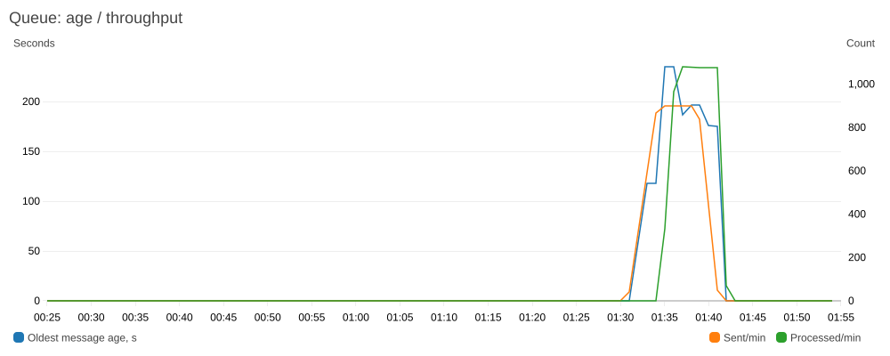
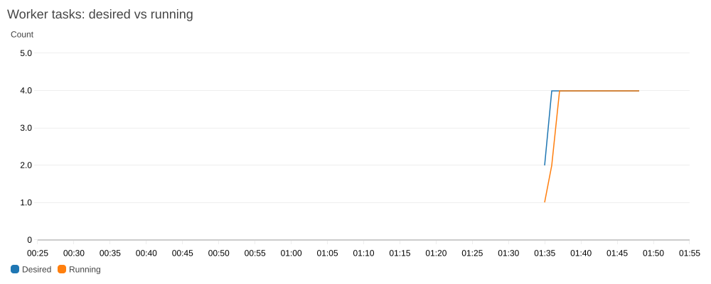

# Запис через чергу

**Покращує:** пік записів не перевантажує сервіс — 6 749 записів за 10 хвилин без жодної помилки, постановка в чергу p95 58 мс, процесор API ≈ 8 % навіть при 2,2 тисячі повідомлень у черзі.  
**Коштує:** 202 замість 201, клієнт мусить перевіряти статус; повторна доставка вимагає ідемпотентності; запуск обробника з нуля ≈ 4 хв.  
**Відкинули:** синхронний запис з довгою операцією, FIFO-чергу (дорожча і повільніша, а дублікати все одно відсікає обробник).

## Як це працює

Для створення філії є окремий запит `POST /libraries/async`. Сервіс не пише в базу одразу, а кладе повідомлення в чергу SQS і відповідає кодом 202. Окремий обробник забирає повідомлення з черги і створює філію. Якщо повідомлення не вдається обробити п'ять разів, воно переходить в окрему чергу для невдалих повідомлень `library-writes-dlq`.

Обробник — це той самий образ, тільки запущений командою `python worker.py`. Перед записом він чекає 200 мс, щоб імітувати довгу операцію. Код у `app/worker.py`, інфраструктура в `infra/sqs.tf` і `infra/worker.tf`.

## Що змінилося для клієнта

Раніше клієнт одразу отримував код 201 і готову філію. Тепер він отримує 202, тобто «прийнято, буде зроблено». Відповідь приходить швидко, але сама філія з'являється трохи пізніше. Якщо, наприклад, такий телефон уже зайнятий, клієнт дізнається про це не одразу, а коли перевірить статус.

## Як клієнт дізнається результат

У відповіді є номер задачі. За ним клієнт перевіряє статус через `GET /jobs/{id}`. Статус буває «в черзі», «обробляється», «готово» з даними філії або «помилка» з причиною. Можна було б зробити, щоб сервер сам повідомляв клієнта, але опитування найпростіше.

## Доставка «щонайменше один раз»

SQS гарантує, що повідомлення не загубиться, але іноді воно приходить двічі. Наприклад, обробник створив філію і впав, не встигнувши видалити повідомлення. Тоді через 30 секунд повідомлення повернеться в чергу, і його візьме інший обробник. Загубити запис гірше, ніж отримати двічі, тому черги працюють саме так.

## Що буде при повторній обробці

Без захисту повторне повідомлення або створило б другу філію, або впало б з помилкою, хоча все вже зроблено. Тому обробник записує номер кожної виконаної задачі в таблицю `processed_jobs`, у тій самій транзакції, що й філію. Якщо таке повідомлення прийде ще раз, обробник побачить номер у таблиці і нічого не запише. Це перевіряє окремий тест.

## Масштабування обробника

Кількість обробників залежить від довжини черги. Поки повідомлень мало, працює один. Що довша черга, то більше обробників, максимум чотири. Якщо черга п'ять хвилин порожня, обробники вимикаються зовсім. До нуля обробник може масштабуватися, бо довжину черги видно навіть тоді, коли не працює жодна задача.

## Навантажувальний тест

```bash
SCRIPT=queue.js RATE=15 ./loadtest/run.sh queue
```

Тест шле лише записи: перші 3 хвилини частота росте до 15 за секунду, 5 хвилин тримається, і 2 хвилини спадає.

## Результати

За 10 хвилин сервіс прийняв 6 749 записів без жодної помилки. Постановка в чергу з погляду клієнта займала 40 мс (p50), 58 мс (p95) і 123 мс (p99). Більшість цього часу — дорога по мережі до Стокгольма.

Процесор API за весь тест не піднявся вище 9 %. Для порівняння, у звичайному сценарії з записами одразу в базу одна задача доходила до 84 %.

Черга росла, бо обробників спочатку не було взагалі. Перший запустився о 01:35, а за цей час у черзі зібралось кілька сотень повідомлень. Найбільше в ній було 2 205 повідомлень, а найстаріше чекало близько 4 хвилин.


Коли спрацював аларм на чергу, повідомлень уже було багато, тому політика швидко підняла кількість обробників до максимуму: о 01:35 працював один, о 01:36 два, о 01:37 усі чотири. Чотири обробники встигали приблизно 1 070 записів за хвилину, а надходило близько 900, тож черга почала зменшуватись ще до кінця тесту і спорожніла о 01:42.



Після того як черга п'ять хвилин була порожня, обробники вимкнулися. Після 01:48 лінія на графіку обривається, бо для сервісу без жодної задачі метрики не публікуються. Тобто повний цикл виглядав так: 0 → 4 → 0.



У черзі невдалих повідомлень за весь тест не з'явилось жодного, тобто жоден запис не загубився.

Затримка до 4 хвилин між відповіддю 202 і реальним записом нормальна для фонової операції, бо клієнт уже отримав відповідь. Якщо треба швидше, можна тримати один обробник завжди ввімкненим. Це коштує близько $0,3 на добу.
