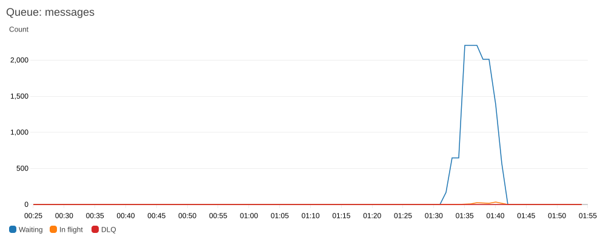

# Запис через чергу

**Покращує:** пік записів не перевантажує базу і не сповільнює API — клієнт отримує відповідь за час постановки в чергу, а не за час запису.  
**Коштує:** `202` замість `201`, клієнт мусить перевіряти статус; черга доставляє «щонайменше один раз», тому обробник мусить бути ідемпотентним; запуск обробника з нуля займає кілька хвилин.  
**Відкинули:** синхронний запис з довгою операцією, FIFO-чергу (дорожча, менша пропускна здатність, а дублікати все одно відсікає обробник).

## Як працює

1. `POST /libraries/async` перевіряє поля, зберігає статус задачі `queued` у Redis і кладе повідомлення в SQS `library-writes`. Відповідь — `202 Accepted` з `job_id` і заголовком `Location: /jobs/<id>`.
2. Обробник (`app/worker.py`, той самий образ, команда `python worker.py`) отримує до 10 повідомлень за раз з long polling 20 с.
3. Для кожного: статус `processing` → пауза `WORKER_DELAY_MS` (200 мс, імітація довгої операції) → запис філії в MySQL → статус `done` з даними або `failed` з причиною.
4. Повідомлення видаляється з черги тільки після успішної обробки. Якщо обробник впав, через 30 с (visibility timeout) повідомлення повернеться в чергу. Після 5 невдалих спроб воно потрапляє в `library-writes-dlq`.

Інфраструктура: `infra/sqs.tf` (черга, DLQ, шифрування SSE), `infra/worker.tf` (сервіс ECS і масштабування), `infra/iam_tasks.tf` (окремі ролі API і обробника). Локально замість SQS — ElasticMQ.

## Що змінюється для клієнта

| | `POST /libraries` | `POST /libraries/async` |
|---|---|---|
| Відповідь | `201` і готова філія | `202` і `job_id` |
| Помилка «телефон уже є» | одразу `409` | статус задачі `failed` |
| Час відповіді | час запису в MySQL | час постановки в чергу |

Статус: `GET /jobs/{id}` → `queued` → `processing` → `done` (з `library_id` і даними) або `failed` (з `error`). Статуси зберігаються в Redis 24 години. Клієнт опитує статус; альтернативи — webhook або WebSocket, але для лабораторної опитування найпростіше.

## Повторна доставка

SQS гарантує, що повідомлення не загубиться, але може доставити його двічі — наприклад, обробник записав філію і впав до видалення повідомлення. Захист: обробник записує `job_id` у таблицю `processed_jobs` **в тій самій транзакції**, що й філію. Перед записом він перевіряє цю таблицю; якщо задача вже є — нічого не пише і позначає `duplicate_delivery: true`. Якщо два обробники взяли одне повідомлення одночасно, другий отримає порушення первинного ключа, відкотиться і поверне результат першого. Це перевіряє тест `test_worker_skips_redelivered_message`.

## Масштабування обробника

| Повідомлень у черзі | Обробників |
|---|---|
| 0 протягом 5 хв (видимих і в обробці) | 0 |
| 1–49 | 1 |
| 50–199 | 2 |
| 200–499 | 3 |
| 500+ | 4 |

На відміну від API, обробник може масштабуватися до нуля: метрика довжини черги існує навіть без жодної задачі, тож аларм `library-queue-backlog` «розбудить» сервіс, щойно з'явиться повідомлення.

## Навантажувальний тест

```bash
SCRIPT=queue.js RATE=15 ./loadtest/run.sh queue
```

Сценарій — лише записи з постійною частотою (15 на секунду в сталій фазі) і унікальним `Idempotency-Key`; кожен десятий запит також перевіряє статус задачі.

## Результати

> Заповнити після прогону в AWS і додати знімки в `docs/img/`.

| Показник | Значення |
|---|---|
| Прийнято записів | |
| Помилок | |
| Постановка в чергу p50 / p95 / p99 | / / мс |
| Максимальна довжина черги | |
| Обробників: 0 → max → 0, час | |
| Повідомлень у DLQ | |




